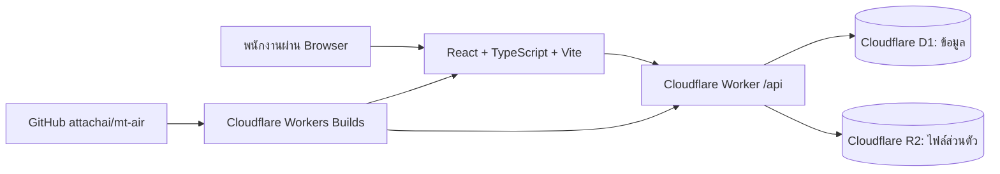

# แผนสร้างระบบดูแลลูกค้าและงานบริการแอร์ (MT Air)

> สถานะ ณ 12 พฤศจิกายน 2026: สร้างแอป React + Worker และฐาน D1 production/preview แล้ว ส่วนการเปิด R2 และการเชื่อม Workers Builds กับ GitHub อยู่ระหว่างดำเนินการ ดูสถานะล่าสุดใน README.md

## 1. เป้าหมายและขอบเขต

สร้างเว็บภาษาไทยสำหรับทีมงานภายใน ใช้บันทึกลูกค้า สถานที่ติดตั้ง เครื่องปรับอากาศ งานติดตั้ง/ล้าง/ซ่อม/ตรวจเช็ก เอกสาร และภาพก่อน–หลังบริการ ลูกค้าเป็นข้อมูลในระบบ ไม่ต้องมีบัญชีเข้าใช้งานในรุ่นแรก

ภาพตัวอย่างที่ให้มาใช้เป็นแนวทางหน้าตา เช่น เมนูด้านข้าง ฟอร์มเพิ่มงาน ตารางค้นหา และรายงาน แต่ขั้นตอนหลักของระบบจะเริ่มจาก **สร้างลูกค้า → เลือกสถานที่/เครื่อง → สร้างงานบริการ → เพิ่มรายละเอียดและไฟล์ → ปิดงาน → ดูรายงาน**

### ขอบเขตรุ่นแรก (MVP)

- ผู้ดูแลระบบเพิ่มบัญชีพนักงานได้; พนักงานเข้าระบบและออกจากระบบได้
- จัดการข้อมูลลูกค้า บุคคล/บริษัท ผู้ติดต่อ เบอร์โทร และหลายสถานที่ต่อหนึ่งลูกค้า
- บันทึกเครื่องปรับอากาศตามสถานที่: ยี่ห้อ รุ่น BTU หมายเลขเครื่อง วันติดตั้ง และหมายเหตุ
- จัดการประเภทบริการและราคาเริ่มต้น เช่น ติดตั้ง ล้าง ซ่อม ตรวจเช็ก โดยบันทึกราคาจริงแยกในแต่ละงาน
- สร้างงานโดยเลือกลูกค้าที่มีอยู่ แล้วเลือกสถานที่ บริการ และเครื่อง (เครื่องเป็นตัวเลือกกรณีติดตั้งใหม่)
- ระบุวันนัด ช่างผู้รับผิดชอบ สถานะงาน รายละเอียด ปัญหา วิธีแก้ และวันนัดล้างครั้งถัดไป
- แนบ PDF และรูป JPG/PNG/WebP ตามงาน โดยแยกชนิดเอกสาร เช่น ใบเสนอราคา ใบบริการ รูปก่อน/หลัง และเอกสารอื่น
- ค้นหา/กรองลูกค้าและงาน ดูประวัติงานย้อนหลังจากหน้าลูกค้าและหน้าของเครื่อง
- Dashboard/รายงานจำนวนงานตามช่วงเวลา ประเภทบริการ สถานะ ลูกค้าที่กลับมาใช้ซ้ำ งานใกล้นัด และช่าง
- รองรับจอคอมพิวเตอร์และมือถือ มีข้อความแจ้งข้อผิดพลาด/สถานะว่าง และสิทธิ์ตามบทบาท

### ระยะถัดไป

- สร้างใบเสนอราคา PDF จากรายการ/ราคาในระบบ, เลขเอกสาร และสถานะอนุมัติ
- ใบแจ้งหนี้/รับชำระเงิน และรายงานรายรับ **เมื่อ** มีการเก็บข้อมูลการชำระเงินจริง
- แจ้งเตือนนัดหมายผ่านอีเมล/LINE, ตารางปฏิทินช่าง, แผนที่, ส่งออก Excel/CSV

## 2. สถาปัตยกรรมที่เลือก

- ใช้ **Cloudflare Worker + Static Assets** เพื่อ deploy React และ API เป็นแอปเดียวจาก GitHub โดยใช้ Cloudflare Vite plugin และ React Router
- เก็บข้อมูลเชิงสัมพันธ์ใน **D1**; ใช้ migration ที่อยู่ใน Git และแยกฐาน production/preview
- เก็บไฟล์ใน **R2 bucket แบบไม่เปิด public**; D1 เก็บเฉพาะ metadata และ key ของไฟล์ การดู/ดาวน์โหลดทุกครั้งต้องผ่าน API ที่ตรวจสิทธิ์
- ตั้งค่า Cloudflare Workers Builds ให้ branch `main` เป็น production; เปิด preview build สำหรับ pull request และผูกทรัพยากร preview แยกจาก production
- ใช้ `wrangler.jsonc` เก็บค่าที่เผยแพร่ได้และ binding; secret อยู่ใน Cloudflare เท่านั้น ห้าม commit รหัสผ่าน/token/ข้อมูลลูกค้า/ไฟล์ลูกค้าเข้า repository สาธารณะ
- เก็บเวลาในฐานข้อมูลเป็น UTC และแสดงเป็นเวลาไทย; รูปแบบวันที่ไทยต้องทดสอบทั้งปี ค.ศ./พ.ศ.

## 3. หน้าจอและเส้นทางหลัก

| หน้า | สิ่งที่ทำได้ |
| --- | --- |
| `/login` | เข้าสู่ระบบ กรณีรหัสผิด/บัญชีปิดใช้งานมีคำอธิบาย |
| `/dashboard` | สรุปงานเดือนนี้ งานรอดำเนินการ นัดถัดไป และประเภทบริการ |
| `/customers` | ค้นหา/กรอง เพิ่มลูกค้า |
| `/customers/:id` | ข้อมูลลูกค้า สถานที่ เครื่อง ประวัติงาน และไฟล์ที่เกี่ยวข้อง |
| `/jobs` | รายการงาน ค้นหาตามลูกค้า วัน สถานะ ประเภทบริการ และช่าง |
| `/jobs/new`, `/jobs/:id` | เลือกลูกค้า/สถานที่/เครื่อง/บริการ บันทึกงาน เปลี่ยนสถานะ แนบรูป/เอกสาร |
| `/services` | ผู้ดูแลระบบจัดการประเภทบริการและราคาเริ่มต้น |
| `/reports` | เลือกช่วงเวลา ดูกราฟ/ตารางสรุปและเจาะไปยังรายการงาน |
| `/settings/users` | ผู้ดูแลระบบจัดการบัญชีและสิทธิ์พนักงาน |

แนวภาพ: เมนูด้านข้างสีน้ำเงินเข้มตามภาพตัวอย่าง แต่เพิ่มเมนู **ลูกค้า** และ **เครื่องแอร์** ให้ชัด; บนมือถือใช้เมนูยุบและแสดงตารางเป็นรายการอ่านง่าย ฟอร์มงานต้องเลือกลูกค้าที่บันทึกไว้ ไม่พิมพ์ชื่อลูกค้าใหม่ซ้ำในทุกงาน

## 4. แบบข้อมูลเบื้องต้น

| ตาราง | ข้อมูลสำคัญ |
| --- | --- |
| `users` | ชื่อ อีเมล บทบาท `admin/staff/technician` สถานะบัญชี password hash |
| `sessions` | token hash, user, วันหมดอายุ, เวลายกเลิก |
| `customers` | ประเภทบุคคล/บริษัท ชื่อ เบอร์ อีเมล หมายเหตุ สถานะ |
| `customer_sites` | customer, ชื่อสถานที่ ที่อยู่ จังหวัด พิกัดถ้ามี ผู้ติดต่อหน้างาน |
| `air_units` | site, ยี่ห้อ รุ่น BTU serial วันติดตั้ง สถานะ/หมายเหตุ |
| `service_catalog` | รหัส ชื่อบริการ หมวดหมู่ ราคาเริ่มต้น สถานะเปิดใช้ |
| `jobs` | เลขงาน customer, site, วันนัด, ช่าง, สถานะ, รายละเอียด, ราคาสรุป, วันนัดถัดไป |
| `job_services` | job, service, air unit (ถ้ามี), จำนวน, ราคาต่อหน่วย, รายละเอียดงาน |
| `attachments` | job, ชนิดไฟล์, R2 key, ชื่อเดิม, MIME, ขนาด, ผู้อัปโหลด, เวลา |
| `audit_logs` | ผู้กระทำ, รายการที่เปลี่ยน, เวลา, ข้อมูลสรุปที่ไม่บันทึก secret |

กำหนด foreign key/index สำหรับ `customer_id`, `site_id`, `job_id`, วันนัด, สถานะ และการค้นหา; ใช้ soft delete/สถานะปิดใช้งานสำหรับลูกค้า บริการ และงานที่มีประวัติ เพื่อไม่ทำลายรายงานย้อนหลัง

### กติกางาน

- สถานะงาน: `new → scheduled → in_progress → completed` และ `cancelled` โดยเก็บเวลาเปลี่ยนสถานะ
- งานหนึ่งมีบริการได้หลายรายการและไฟล์ได้หลายไฟล์; ราคาบริการในงานต้องเป็น snapshot เพื่อไม่เปลี่ยนย้อนหลังเมื่อแก้ราคากลาง
- ก่อนเพิ่มงานต้องเลือกลูกค้าและสถานที่ที่มีอยู่; หากเป็นงานติดตั้งใหม่ เพิ่มเครื่องหลังติดตั้งได้
- ประเภทบริการที่ปิดใช้งานต้องยังปรากฏในงานเก่า แต่เลือกสร้างงานใหม่ไม่ได้
- รายงาน “รายรับ” ไม่แสดงจากราคาเสนอหรือราคางาน หากยังไม่มีข้อมูลรับชำระเงินจริง

## 5. ความปลอดภัยและการดูแลข้อมูล

- API ทุกจุดที่อ่าน/แก้ข้อมูลลูกค้าและไฟล์ตรวจ session และบทบาทฝั่ง Worker; React ซ่อนเมนูเพื่อ UX เท่านั้น
- เก็บรหัสผ่านแบบ hash ที่เหมาะสมพร้อม salt; session ใช้ cookie `HttpOnly`, `Secure`, `SameSite` และมีวันหมดอายุ; ป้องกัน CSRF, จำกัดการลองรหัสผิด และรองรับการปิดบัญชี
- ตรวจชนิด/ขนาดไฟล์ทั้งฝั่งเว็บและ Worker; ค่าเริ่มต้นสูงสุด 10 MB/ไฟล์ ปรับได้; ตั้งชื่อ object ใหม่แบบสุ่ม ไม่ใช้ชื่อจากผู้ใช้เป็น path
- จำกัดไฟล์เป็น PDF/JPG/PNG/WebP; เสิร์ฟผ่าน endpoint ที่ตรวจสิทธิ์พร้อม header ที่ปลอดภัย; บันทึกผู้เพิ่ม/ลบ และไม่เปิด R2 bucket เป็น public
- ตรวจ input, ใช้ parameterized SQL, เก็บ log เท่าที่จำเป็น, ไม่ส่งข้อมูลลูกค้าเข้าระบบ analytics ภายนอก
- ใช้ D1 Time Travel สำหรับกู้ข้อมูลระยะสั้น และกำหนดการส่งออกสำรองระยะยาวพร้อมทดสอบกู้คืน; กำหนดนโยบายเก็บ/ลบไฟล์และข้อมูลลูกค้าก่อนเปิดใช้งานจริง

## 6. TODO ตามลำดับทำงาน

### P0 — ตั้งต้นโปรเจกต์และขอบเขต

- [ ] ยืนยันชื่อระบบ โลโก้ และโดเมนที่จะใช้ (เริ่มจาก `workers.dev` ได้)
- [ ] กำหนดข้อมูลบังคับของลูกค้า/สถานที่/เครื่อง และตัวอย่างงานจริง 3–5 กรณี
- [ ] ยืนยันว่ารุ่นแรกเป็นระบบของพนักงานเท่านั้น; ระบุผู้ดูแลระบบคนแรกโดยไม่ใส่รหัสผ่านใน Git
- [ ] กำหนดชนิดไฟล์/ขนาดสูงสุด/ระยะเวลาเก็บข้อมูลและสิทธิ์ของแต่ละบทบาท
- [ ] ตรวจค่าใช้จ่าย/โควตาของ Cloudflare; เปิดใช้งาน R2 โดยเจ้าของบัญชีเมื่อพร้อม เพราะ R2 ต้องมี subscription แม้มี free monthly usage

**ผ่านเมื่อ:** ตอบรายการข้อมูลและสิทธิ์ได้ครบ, มีตัวอย่างงานที่ใช้ทดสอบ, R2 ใช้งานได้ก่อนเริ่มฟีเจอร์ไฟล์

### P1 — โครงแอปและ Cloudflare

- [ ] สร้าง React + TypeScript + Vite, Cloudflare Vite plugin, Worker API, React Router
- [ ] ตั้งค่า lint/typecheck/build, README, `.gitignore`, `.env.example`, `wrangler.jsonc`
- [ ] สร้าง D1 production/preview และ R2 production/preview แบบแยกกัน แล้วกำหนด binding
- [ ] สร้าง migration และ seed เฉพาะประเภทบริการตัวอย่าง; ไม่ seed ข้อมูลลูกค้าจริงลง Git
- [ ] เชื่อม GitHub `attachai/mt-air` กับ Workers Builds; ตั้ง branch `main` และ preview builds
- [ ] กำหนดขั้นตอนรัน migration ที่ควบคุมได้ก่อน deploy เวอร์ชันที่ใช้ schema ใหม่

**ผ่านเมื่อ:** หน้าเริ่มต้นกับ `/api/health` ทำงานทั้ง local และ preview, production deploy จาก Git ได้, preview ไม่แตะฐาน/ไฟล์ production

### P2 — Login และสิทธิ์

- [ ] ทำหน้า login/logout และ API สร้าง/ยกเลิก session
- [ ] ทำ bootstrap ผู้ดูแลระบบคนแรกผ่านขั้นตอนที่ปลอดภัยและไม่ commit credential
- [ ] ทำ middleware ตรวจ session/บทบาท; หน้าและ API ที่ไม่อนุญาตตอบ 401/403 ถูกต้อง
- [ ] ทำหน้าจัดการพนักงานสำหรับ admin และ audit log ขั้นพื้นฐาน
- [ ] ทดสอบรหัสผิด หมดอายุ ปิดบัญชี และการเรียก API โดยไม่ login

**ผ่านเมื่อ:** ผู้ไม่มีสิทธิ์ไม่อ่านข้อมูลลูกค้าหรือไฟล์ได้แม้เรียก API โดยตรง

### P3 — ลูกค้า สถานที่ และเครื่อง

- [ ] เพิ่ม/แก้/ค้นหาลูกค้า พร้อมตรวจเบอร์/ข้อมูลซ้ำที่อาจเป็นลูกค้าคนเดิม
- [ ] เพิ่มหลายสถานที่และผู้ติดต่อหน้างานต่อลูกค้า
- [ ] เพิ่ม/แก้เครื่องแอร์ตามสถานที่ พร้อมประวัติงานของเครื่อง
- [ ] ทำหน้ารายละเอียดลูกค้ารวมประวัติงานและลิงก์สร้างงานใหม่

**ผ่านเมื่อ:** สร้างลูกค้า → สถานที่ → เครื่อง และค้นพบข้อมูลเดิมได้โดยไม่ต้องกรอกซ้ำ

### P4 — บริการและงาน

- [ ] CRUD ประเภทบริการโดย admin; ปิดใช้งานได้โดยไม่กระทบงานเก่า
- [ ] ฟอร์มสร้างงานแบบเลือก customer/site/service/air unit และเพิ่มบริการหลายรายการ
- [ ] รายการงานพร้อมค้นหา กรอง เรียง และแบ่งหน้า
- [ ] รายละเอียดงาน: วันนัด ช่าง สถานะ บันทึกผล รูปแบบราคา และวันนัดครั้งถัดไป
- [ ] บันทึกประวัติเปลี่ยนสถานะและผู้แก้ไข

**ผ่านเมื่อ:** ทำรายการตั้งแต่รับงานจนปิดงานได้ และเปิดประวัติย้อนหลังจากลูกค้า/เครื่องได้

### P5 — ไฟล์และเอกสาร

- [ ] ทำ upload API ไป R2 พร้อมตรวจสิทธิ์ ชนิด ขนาด และข้อผิดพลาด
- [ ] ผูกไฟล์กับงานและระบุชนิดเอกสาร; รองรับหลายไฟล์และรูปก่อน/หลัง
- [ ] ทำดูตัวอย่าง/ดาวน์โหลดผ่าน API ที่ตรวจสิทธิ์ และการลบแบบมี audit trail
- [ ] ทดสอบไฟล์ไม่ถูกชนิด/ใหญ่เกิน/อัปโหลดค้าง/ผู้ไม่มีสิทธิ์เข้าถึง

**ผ่านเมื่อ:** ผู้มีสิทธิ์แนบและเปิด PDF/รูปได้จากงานที่ถูกต้อง; URL ของ R2 ไม่เปิดข้อมูลให้คนทั่วไป

### P6 — Dashboard และรายงาน

- [ ] สรุปจำนวนงานรายเดือน/ประเภท/สถานะ และลูกค้าใหม่เทียบลูกค้ากลับมาใช้ซ้ำ
- [ ] แสดงงานใกล้นัด งานค้าง และรายงานภาระงานช่าง
- [ ] เพิ่มตัวกรองช่วงเวลาและลิงก์เจาะจากตัวเลขไปยังรายการงาน
- [ ] ทดสอบตัวเลขกับข้อมูลตัวอย่างรวมถึงงานยกเลิก งานหลายบริการ และเขตเวลาไทย

**ผ่านเมื่อ:** ตัวเลขรายงานตรวจย้อนกลับไปยังรายการจริงได้และไม่รวมงานยกเลิกผิดประเภท

### P7 — ตรวจคุณภาพและเปิดใช้งาน

- [ ] ทดสอบ flow จริงบน desktop/mobile: login → ลูกค้า → เครื่อง → งาน → ไฟล์ → ปิดงาน → รายงาน
- [ ] ทดสอบสิทธิ์/API, validation, ความปลอดภัยไฟล์, migration และการกู้คืน D1
- [ ] ใส่ข้อมูลเริ่มต้นจริงผ่านหน้าแอปหรือ import ที่ตรวจสอบแล้ว; ห้ามใส่ไฟล์ลูกค้าใน Git
- [ ] ตั้งค่าโดเมนและตรวจ deployment, error logs, backup/retention, ค่าใช้จ่าย
- [ ] เขียนคู่มือพนักงานสั้น ๆ และ checklist ดูแลระบบ

**ผ่านเมื่อ:** ใช้งานบน production ได้ครบ flow, เปิดไฟล์ได้เฉพาะผู้มีสิทธิ์, รายงานตรงกับข้อมูล, มีวิธีกู้ข้อมูลและคู่มือ

## 7. แหล่งอ้างอิง Cloudflare

- [React + Vite บน Workers](https://developers.cloudflare.com/workers/framework-guides/web-apps/react/)
- [Workers Static Assets](https://developers.cloudflare.com/workers/static-assets/)
- [Workers Builds และ Git integration](https://developers.cloudflare.com/workers/ci-cd/builds/)
- [D1 limits](https://developers.cloudflare.com/d1/platform/limits/) และ [Time Travel](https://developers.cloudflare.com/d1/reference/time-travel/)
- [R2 get started](https://developers.cloudflare.com/r2/get-started/) และ [การอัปโหลด object](https://developers.cloudflare.com/r2/objects/upload-objects/)
